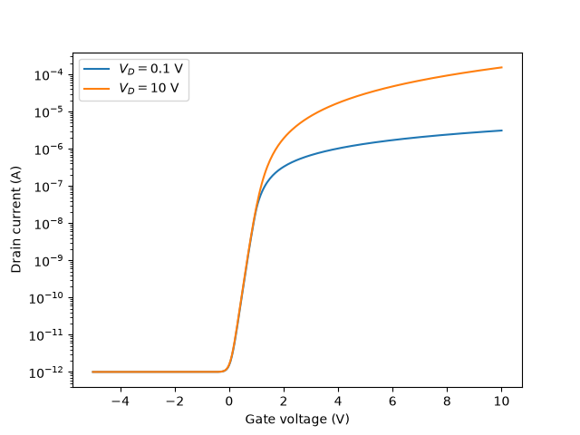
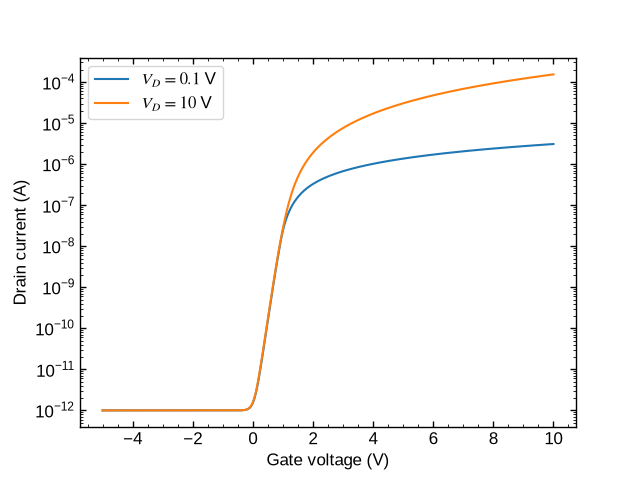
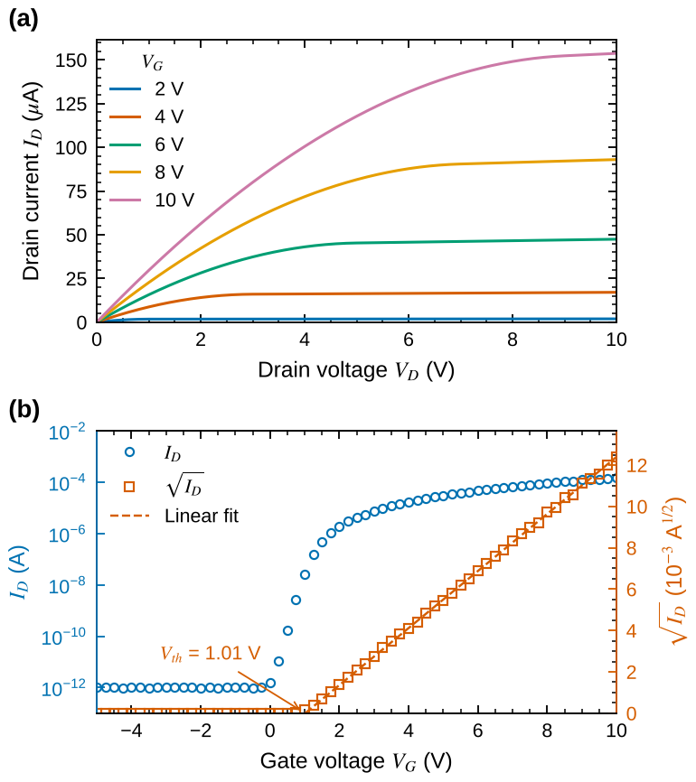

論文の図は「見やすい」だけでは足りず、雑誌ごとの**大きさ・文字サイズ・線の太さ・ファイル形式**の決まりを満たす必要があります。
ここでは、自分の解析ツール群に入れているグラフ描画ヘルパー `plot_style.py` / `plot_utils.py` を出発点に、科学誌に出せる図に仕上げるまでの手順をまとめます。

> [!NOTE] ソースの場所
> `plot_style.py` と `plot_utils.py` のソース全文は[下の節](#モジュールのソース)に、簡易 GUI の `plot_gui.py` は[記事の最後](#補足簡易-guiplot_guipy)に載せています([`plot_style.py`](plot_style.py)・[`plot_utils.py`](plot_utils.py)・[`plot_gui.py`](plot_gui.py) からダウンロードもできます)。
> コードはどれも [MIT ライセンス](#ライセンス)で、自由に使えます。
> コード例の `from plot_style import ...` などは、この 2 ファイルを実行するスクリプトと同じフォルダに置くか、そのフォルダを `PYTHONPATH` に入れて動かします。

## 科学誌が求める図の条件

投稿規定は雑誌ごとに違いますが、多くの雑誌で次の点が共通しています。

| 項目 | よくある要件 | 補足 |
|---|---|---|
| 図の幅 | 1 段幅と 2 段幅のどちらかに合わせる | 例:Nature 系 89 mm / 183 mm、Elsevier 系 90 mm / 190 mm、Physical Review 系 8.6 cm / 17.8 cm |
| 文字サイズ | **仕上がりの大きさで** 6〜9 pt 程度 | 大きく描いて縮小すると文字が小さくなりすぎる |
| 線の太さ | 0.5 pt 以上 | 細すぎる線は印刷でかすれる |
| フォント | Arial / Helvetica などのサンセリフ体 | 図の中でフォントを混ぜない |
| ファイル形式 | ベクター(PDF・EPS・SVG)、またはラスター 300〜600 dpi 以上 | 線画のラスターは 1000 dpi 程度を求められることもある |
| フォントの埋め込み | PDF / EPS にフォントを埋め込む | Type 3 フォントを嫌う雑誌が多い |
| 色 | 色覚の多様性に配慮し、白黒印刷でも区別できる | 色だけでなく線種や記号でも区別する |
| 軸ラベル | 物理量と単位をそろえて書く | 例:`Voltage (V)`、`Current density (A cm⁻²)` |
| 複数パネル | (a)、(b) のラベルを付ける | 本文や図の説明から参照するため |

> [!WARNING]
> 上の数値は代表例です。投稿前に、必ず投稿先の最新の投稿規定(Author guidelines の Figures の項)を確認してください。

## 描画ヘルパーの構成

グラフ描画まわりは 3 つのモジュールに分けています。

| ファイル(モジュール) | 主な関数 | 役割 |
|---|---|---|
| `plot_style.py` | `apply_style()` | 論文用の `rcParams` をまとめて設定する |
| `plot_utils.py` | `read_column()`、`new_figure()`、`new_twinx_figure()`、`combine_twinx_legend()` | ヘッダなし CSV の列読み込み、図の作成、左右 2 軸の凡例の統合 |
| `plot_gui.py` | — | 上の 2 つを使った tkinter の簡易グラフ作成 GUI(実行ファイル) |

この記事のコード例で、どの関数がどのモジュールのものかは次のとおりです。`plt.` や `ax.` で始まるものは matplotlib 本体の関数です。

| 関数 | モジュール |
|---|---|
| `apply_style()` | `plot_style.py` |
| `new_figure()`、`new_twinx_figure()`、`read_column()`、`combine_twinx_legend()` | `plot_utils.py` |
| `plt.subplots()`、`plt.rcParams`、`fig.savefig()`、`ax.plot()` など | matplotlib(`matplotlib.pyplot`) |

### `apply_style()`(`plot_style.py`)が設定すること

| 設定 | 値 | ねらい |
|---|---|---|
| `font.family` | `Arial` | 本文のフォントをサンセリフ体にそろえる |
| `mathtext.fontset` | `stix` | 数式を Times 系のイタリックで組む(物理系の雑誌でよく見る組み方) |
| `font.size` / 目盛りラベル | 12 pt / 引数 `tick_labelsize`(既定 12) | |
| `xtick.direction` / `ytick.direction` | `in` | 目盛りを内向きにする |
| `xtick.top` / `ytick.right` | `True` | 上と右の辺にも目盛りを付ける(箱型の枠) |
| `xtick.minor.visible` / `ytick.minor.visible` | `True` | 補助目盛りを表示する |
| 主目盛り / 補助目盛りの長さ・太さ | 4.0 / 1.0、2.0 / 0.6(すべて引数で変更可) | |
| `axes.linewidth` | 1.0 | 枠線の太さ |

matplotlib の初期設定で描いた図 1 と、`apply_style()` と `new_figure()` だけを使った図 2 を比べると、目盛りが内向きで四辺に付き、補助目盛りが入ることで、論文でよく見る形に近づきます。



*図 1:matplotlib の初期設定のまま描いた図(トランジスタの伝達特性。線形領域 $V_D = 0.1$ V と飽和領域 $V_D = 10$ V)。目盛りは外向きで左と下だけ、補助目盛りはない。*



*図 2:`apply_style()` と `new_figure()` で描いた図。目盛りが内向きで四辺に付き、補助目盛りが入る。*

<p class="code-label">図 2 のコード ― 使うモジュール:<code>plot_style.py</code>(<code>apply_style</code>)、<code>plot_utils.py</code>(<code>new_figure</code>)</p>

```python
from matplotlib import pyplot as plt
from plot_style import apply_style   # 記事の plot_style.py
from plot_utils import new_figure    # 記事の plot_utils.py

apply_style()             # 論文用の rcParams を一括で設定
fig, ax = new_figure()    # 6.4 × 4.8 インチ、200 dpi、背景は白(軸の領域だけ透明)
# vg: ゲート電圧の配列、drain_current(): I_D のモデル(figure_example.py と同じ)
ax.semilogy(vg, drain_current(vg, 0.1), label="$V_D = 0.1$ V")
ax.semilogy(vg, drain_current(vg, 10.0), label="$V_D = 10$ V")
ax.set_xlabel("Gate voltage (V)")
ax.set_ylabel("Drain current (A)")
ax.legend()
plt.show()
```

## モジュールのソース

記事で使っている 2 つのモジュールの全文です。`plot_utils.py` は CSV の読み込みに pandas を使います(`read_column()` を使わないなら不要です)。

<p class="code-label"><a href="plot_style.py"><code>plot_style.py</code></a>(44 行)― 論文用の <code>rcParams</code> を一括で設定する <code>apply_style()</code></p>

```python
"""論文用グラフの共通Matplotlibスタイル設定。

複数のグラフ描画スクリプトで重複しがちな rcParams 設定をまとめたもの。
スクリプトごとに微妙に異なる目盛り線サイズ・ラベルサイズは引数で指定する。
"""

from matplotlib import pyplot as plt


def apply_style(
    tick_labelsize: int | None = 12,
    major_size: float = 4.0,
    major_width: float = 1.0,
    minor_size: float = 2.0,
    minor_width: float = 0.6,
) -> None:
    """論文用グラフの共通rcParamsを適用する。

    tick_labelsize=None の場合は xtick/ytick.labelsize を変更しない
    （元々未設定のスクリプトの挙動を保ちたい場合に使う）。
    """
    plt.rcParams["font.family"] = "Arial"
    plt.rcParams["mathtext.fontset"] = "stix"
    plt.rcParams["font.size"] = 12
    if tick_labelsize is not None:
        plt.rcParams["xtick.labelsize"] = tick_labelsize
        plt.rcParams["ytick.labelsize"] = tick_labelsize
    plt.rcParams["xtick.direction"] = "in"
    plt.rcParams["ytick.direction"] = "in"
    plt.rcParams["axes.linewidth"] = 1.0
    plt.rcParams["xtick.top"] = True
    plt.rcParams["xtick.bottom"] = True
    plt.rcParams["ytick.left"] = True
    plt.rcParams["ytick.right"] = True
    plt.rcParams["xtick.minor.visible"] = True
    plt.rcParams["ytick.minor.visible"] = True
    plt.rcParams["xtick.major.size"] = major_size
    plt.rcParams["ytick.major.size"] = major_size
    plt.rcParams["xtick.major.width"] = major_width
    plt.rcParams["ytick.major.width"] = major_width
    plt.rcParams["xtick.minor.size"] = minor_size
    plt.rcParams["ytick.minor.size"] = minor_size
    plt.rcParams["xtick.minor.width"] = minor_width
    plt.rcParams["ytick.minor.width"] = minor_width
```

<p class="code-label"><a href="plot_utils.py"><code>plot_utils.py</code></a>(41 行)― CSV の列読み込みと、図の作成のヘルパー</p>

```python
"""実験データCSVからのMatplotlibグラフ作成で共通利用するヘルパー。"""

import pandas as pd
from matplotlib import pyplot as plt
from matplotlib.axes import Axes
from matplotlib.figure import Figure

FIGSIZE = (6.4, 4.8)
DPI = 200


def read_column(csvfile: str, col: int) -> pd.DataFrame:
    """CSVから指定した1列（ヘッダなし）を読み込む。"""
    return pd.read_csv(csvfile, header=None, usecols=[col])


def new_figure() -> tuple[Figure, Axes]:
    """透明背景・単一軸の図を作成する。"""
    fig = plt.figure(
        figsize=FIGSIZE, dpi=DPI, facecolor="w", linewidth=0, edgecolor="w"
    )
    ax = fig.add_subplot(111)
    ax.patch.set_alpha(0)
    return fig, ax


def new_twinx_figure() -> tuple[Figure, Axes, Axes]:
    """透明背景・双方向Y軸（twinx）の図を作成する。"""
    fig, ax1 = plt.subplots(figsize=FIGSIZE, dpi=DPI, facecolor="w", edgecolor="w")
    ax1.patch.set_alpha(0)
    ax2 = ax1.twinx()
    return fig, ax1, ax2


def combine_twinx_legend(ax1: Axes, ax2: Axes, loc=2, borderaxespad: float = 0.0):
    """twinx で分かれた2軸の凡例を1つにまとめて ax1 に表示する。"""
    handler1, label1 = ax1.get_legend_handles_labels()
    handler2, label2 = ax2.get_legend_handles_labels()
    ax1.legend(
        handler1 + handler2, label1 + label2, loc=loc, borderaxespad=borderaxespad
    )
```

## そのまま雑誌に出すときの注意

`apply_style()` と `new_figure()` は「論文っぽい見た目」までは整えてくれますが、そのまま投稿するには次の点に気をつけます。

1. **図の大きさが 6.4 × 4.8 インチ(約 163 × 122 mm)に固定されている。** 1 段幅(約 89 mm)に縮小すると、12 pt の文字は約 6.5 pt まで小さくなります。投稿用の図は `new_figure()` を使わず、**仕上がりの大きさで** `plt.subplots(figsize=...)` を作り、文字サイズも仕上がりの値(8 pt など)で指定するのが確実です。
2. **Arial が入っていない環境では別のフォントに置き換わる。** `font.family = "Arial"` だけを指定しているため、Linux などでは警告を出して DejaVu Sans になります。`font.sans-serif` に候補を並べておくと、Arial と字幅が同じ Liberation Sans などに置き換えられます。
3. **数式だけフォントが変わる。** `mathtext.fontset = "stix"` なので、`$n = 1.0$` のような数式部分は Times 系になります。物理系では一般的な組み方ですが、数式もサンセリフ体にそろえたい場合は `"stixsans"` を使います。
4. **軸の領域だけが透明になる。** `new_figure()` は図全体の背景を白にし、軸の内側だけを透明にします。そのまま保存した PNG は白背景で問題ありません。ただし `savefig(..., transparent=True)` を付けると図全体が透明になり、閲覧ソフトによっては背景が黒く見えるので、投稿用には付けないでおきます。
5. **設定がプログラム全体に効く。** `apply_style()` は `plt.rcParams` を直接書き換えます。同じプログラムで別の体裁の図も描くなら、`plt.rcdefaults()` で戻すか、`with plt.rc_context(...):` の中で描きます。

> [!TIP]
> PDF に保存するときは `pdf.fonttype = 42` を設定すると、フォントが TrueType のまま埋め込まれます。既定の Type 3 のままだと、投稿システムで警告が出たり、文字を編集できなかったりします。

## 完成例:トランジスタ特性(副軸つき)

`apply_style()` を土台にして、文字サイズと線の太さを 1 段幅(89 mm)の仕上がりに合わせ、色覚の多様性に配慮した配色を加えた例です。題材は薄膜トランジスタ(n 型)の特性で、上下 2 段のパネルにしています。

- **(a) 出力特性**:ゲート電圧 $V_G$ ごとのドレイン電流 $I_D$–ドレイン電圧 $V_D$。
- **(b) 伝達特性**:飽和領域($V_D = 10$ V)での $I_D$–$V_G$。左軸に $\log I_D$、右の**副軸**に $\sqrt{I_D}$ をとります。飽和領域では $I_D = \frac{W}{2L}\mu C_i (V_G - V_{th})^2$ なので、$\sqrt{I_D}$ は $V_G$ に対して直線になり、その直線と横軸との交点からしきい値電圧 $V_{th}$ が、傾きから飽和移動度が求まります。1 枚の図で、オフ電流やサブスレッショルドスイング(左軸)と、しきい値電圧(右軸)を同時に読めるのが、この描き方の利点です。

データは二乗則のモデルに 2 % のばらつきを加えて作った模擬データです(しきい値電圧 1.0 V、移動度 10 cm²/Vs、サブスレッショルドスイング 0.2 V/dec)。



*図 3:1 段幅 89 mm、文字 8 pt で仕上げた図。(b) の破線は $\sqrt{I_D}$ の直線部分($V_G$ = 5〜10 V)の近似直線。印刷用の [PDF 版](fig-journal.pdf)(フォントは TrueType で埋め込み済み)。*

下のコードは、データを作る部分(`vg`、`id_meas` などの配列と近似直線の係数)を省いた描画部分の抜粋です。動作には Python 3.10 以上と matplotlib 3.6 以上が必要です。データの作成まで含めてそのまま動くスクリプトは [`figure_example.py`](figure_example.py) にあります(この記事の [`plot_style.py`](plot_style.py)・[`plot_utils.py`](plot_utils.py) と同じフォルダに置いて実行します)。

<p class="code-label">図 3 のコード(<a href="figure_example.py"><code>figure_example.py</code></a> の抜粋)― 使うモジュール:<code>plot_style.py</code>(<code>apply_style</code>)、<code>plot_utils.py</code>(<code>combine_twinx_legend</code>)。図は <code>new_figure()</code> を使わず、matplotlib の <code>plt.subplots()</code> で仕上がりの大きさに作る</p>

```python
from matplotlib import pyplot as plt
from plot_style import apply_style            # 記事の plot_style.py
from plot_utils import combine_twinx_legend   # 記事の plot_utils.py

MM = 1 / 25.4  # mm → インチ

# 1) 土台:目盛りは仕上がりサイズ向けに細く短く
apply_style(tick_labelsize=7, major_size=3.0, major_width=0.6,
            minor_size=1.5, minor_width=0.5)   # 線は 0.5 pt 以上

# 2) 雑誌向けの上書き
plt.rcParams.update({
    "font.family": "sans-serif",
    "font.sans-serif": ["Arial", "Liberation Sans", "DejaVu Sans"],
    "font.size": 8,
    "axes.labelsize": 8,
    "legend.fontsize": 7,
    "axes.linewidth": 0.6,
    "lines.linewidth": 1.0,
    "lines.markersize": 3.0,
    "legend.frameon": False,
    "pdf.fonttype": 42,       # フォントを TrueType で埋め込む
    "ps.fonttype": 42,
    "svg.fonttype": "none",   # SVG では文字を文字のまま残す
})
# savefig.bbox="tight" は使わない(余白が削られて図の幅が 89 mm より小さくなる)。
# 余白の調整は layout="constrained" に任せる
OKABE_ITO = ["#0072B2", "#D55E00", "#009E73", "#E69F00", "#CC79A7"]
C_LEFT, C_RIGHT = "#0072B2", "#D55E00"   # 主軸と副軸の色

# 3) 仕上がりの大きさで図を作る(1 段幅 89 mm、上下 2 段)
fig, (ax1, ax2) = plt.subplots(2, 1, figsize=(89 * MM, 100 * MM),
                               layout="constrained")

# (a) 出力特性:ゲート電圧ごとに色を変える
for v, c in zip(vg_steps, OKABE_ITO, strict=True):
    ax1.plot(vd, drain_current(v, vd) * 1e6, color=c, label=f"{v} V")
ax1.set_xlabel(r"Drain voltage $V_D$ (V)")
ax1.set_ylabel(r"Drain current $I_D$ ($\mu$A)")
ax1.set_xlim(0, 10)
ax1.set_ylim(0, None)
ax1.legend(title=r"$V_G$", loc="upper left")

# (b) 伝達特性:左軸 log I_D、右の副軸 sqrt(I_D)
ax2r = ax2.twinx()
# apply_style() は右辺にも目盛りを付けるので、主軸の右目盛りと副軸の左目盛りを消す
ax2.tick_params(axis="y", which="both", right=False)
ax2r.tick_params(axis="y", which="both", left=False, right=True)

ax2.semilogy(vg, id_meas, "o", color=C_LEFT, markerfacecolor="none",
             markeredgewidth=0.7, label=r"$I_D$")
ax2r.plot(vg, sqrt_id * 1e3, "s", color=C_RIGHT, markerfacecolor="none",
          markeredgewidth=0.7, label=r"$\sqrt{I_D}$")
v_line = np.linspace(vth_ext, 10, 20)   # 近似直線は V_th から描く
ax2r.plot(v_line, (slope * v_line + icpt) * 1e3, "--", color=C_RIGHT,
          linewidth=0.8, label="Linear fit")

ax2.set_xlabel(r"Gate voltage $V_G$ (V)")
ax2.set_ylabel(r"$I_D$ (A)", color=C_LEFT)
ax2r.set_ylabel(r"$\sqrt{I_D}$ (10$^{-3}$ A$^{1/2}$)", color=C_RIGHT)
# 軸ラベル・目盛り・枠線の色を系列の色にそろえ、どちらの軸で読むかを示す
ax2.tick_params(axis="y", colors=C_LEFT)
ax2r.tick_params(axis="y", colors=C_RIGHT)
ax2r.spines["left"].set_color(C_LEFT)
ax2r.spines["right"].set_color(C_RIGHT)
ax2.set_xlim(-5, 10)
ax2.set_ylim(1e-13, 1e-2)
ax2r.set_ylim(0, sqrt_id.max() * 1e3 * 1.1)   # 下端を 0 にして V_th の矢印を横軸に置く

# しきい値電圧(外挿)を矢印で示す
ax2r.annotate(rf"$V_{{th}}$ = {vth_ext:.2f} V", xy=(vth_ext, 0),
              xytext=(vth_ext - 4.2, 2.6), fontsize=7, color=C_RIGHT,
              arrowprops={"arrowstyle": "->", "color": C_RIGHT, "lw": 0.6})

# 主軸と副軸の凡例を 1 つにまとめる
combine_twinx_legend(ax2, ax2r, loc="upper left", borderaxespad=0.3)

# 4) パネルラベル
for ax, tag in [(ax1, "(a)"), (ax2, "(b)")]:
    ax.text(-0.17, 1.03, tag, transform=ax.transAxes,
            fontsize=9, fontweight="bold", va="bottom")

# 5) 保存:ベクター(投稿用)と高解像度ラスター
fig.savefig("figure1.pdf")
fig.savefig("figure1.png", dpi=600)
```

ポイントは次の 5 つです。

- **大きさは仕上がりで決める。** `figsize` をミリメートルから換算して指定し、文字サイズ・線の太さもその大きさでの値にします。あとから縮小しないので、文字が規定より小さくなりません。
- **色覚の多様性に配慮した色を使う。** 配色には、色覚の多様性に配慮して選ばれた Okabe–Ito のパレット(岡部正隆・伊藤啓「カラーユニバーサルデザイン」)を使っています。
- **副軸は「どちらの軸で読むか」を色で示す。** 系列の色と、その軸のラベル・目盛り・枠線の色をそろえます。さらに記号の形(○ と □)も変えておくと、白黒印刷でも区別できます。
- **副軸と `apply_style()` の目盛りを両立させる。** `apply_style()` は四辺に目盛りを付けるため、そのまま `twinx()` を使うと右側で主軸と副軸の目盛りが重なります。主軸の右目盛りと副軸の左目盛りを消してから描きます。凡例は `combine_twinx_legend()` で 1 つにまとめます。
- **測定点とモデルを描き分ける。** 測定点は白抜きの記号、近似直線は同じ色の破線にすると、何が実験で何が計算かが一目でわかります。求めた $V_{th}$ も図の中に書き込みます。
- **ベクターで保存する。** PDF(`pdf.fonttype = 42`)で保存すれば、拡大しても劣化せず、雑誌側でも文字を扱えます。ラスターが必要なときは 600 dpi 以上で書き出します。

> [!NOTE]
> 模擬データから求めた飽和移動度は約 11 cm²/Vs で、モデルに入れた 10 cm²/Vs より少し大きくなります。チャネル長変調($V_D = 10$ V で電流が 1.1 倍)の分を移動度とみなしているためで、実測でも同じことが起こります。

## 投稿前のチェックリスト

- [ ] 図の幅が投稿先の 1 段幅または 2 段幅になっている
- [ ] 仕上がりの大きさで、いちばん小さい文字が規定(6〜7 pt 程度)以上ある
- [ ] 線の太さが 0.5 pt 以上ある
- [ ] 軸ラベルに物理量と単位が書かれている
- [ ] 色だけに頼らず、線種や記号でも系列を区別できる
- [ ] 複数パネルに (a)、(b) のラベルがある
- [ ] PDF / EPS にフォントが埋め込まれている(Type 3 になっていない)
- [ ] ラスター画像は規定の解像度(300〜600 dpi 以上)になっている

## 補足:簡易 GUI(`plot_gui.py`)

スクリプトを書かずに CSV のグラフをすばやく確認したいときは、同じスタイルを使った tkinter の GUI(`plot_gui.py`)が使えます。CSV を選んで列番号を指定すると複数系列を重ね描きでき、軸ラベル・範囲・対数/線形スケール・凡例の位置を画面上で調整して PNG に保存できます。
ただし、図の大きさは `new_figure()` と同じ 6.4 × 4.8 インチなので、確認用と割り切り、投稿用の図は上の完成例のようにスクリプトで仕上げるのがおすすめです。

### 起動

[`plot_gui.py`](plot_gui.py) を [`plot_style.py`](plot_style.py)・[`plot_utils.py`](plot_utils.py) と同じフォルダに置き、次のコマンドで起動します。Python 3.10 以上で、tkinter(Python 標準。Linux では `python3-tk` などのパッケージを別に入れることがあります)のほかに、matplotlib と pandas が必要です。

```bash
python plot_gui.py
```

### 読み込める CSV

**ヘッダ(見出し行)のない**、カンマ区切りの CSV を読みます。列は左から 0、1、2… と数えます。
試しに使える [`sample_iv.csv`](sample_iv.csv) を置いておきます。0 列目が電圧 [V]、1 列目と 2 列目が理想係数 $n = 1$ と $n = 2$ のダイオードの電流 [A] です。

```text
0.000,0.000000e+00,0.000000e+00
0.020,1.167630e-12,4.722874e-13
0.040,3.698621e-12,1.167630e-12
```

### 操作の流れ

画面の左側で設定し、右側にグラフが表示されます。

1. **CSV ファイル**:「参照...」を押して CSV を選びます。
2. **系列を追加する**:次の項目を入れて「系列を追加」を押します。追加した系列は一覧に並び、何本でも重ね描きできます。間違えた系列は一覧で選んで「選択した系列を削除」で消せます。

   | 項目 | 入れるもの | 例 |
   |---|---|---|
   | X 列・Y 列 | 横軸・縦軸に使う列の番号(0 から数える) | `0`、`1` |
   | ラベル | 凡例に出す名前(数式は `$...$` で書ける) | `$n = 1$` |
   | 色・線種 | 一覧から選ぶ | `blue`、`dashed` |
   | Y 倍率 | 縦軸の値に掛ける数。単位を変えるときに使う | A を μA で表示するなら `1e6` |

3. **軸と凡例**:タイトル、X / Y ラベル、X / Y 範囲、Y スケール(`linear` か `log`)、凡例の位置、目盛りの文字サイズを決めます。範囲は**最小と最大の両方**を入れたときだけ効きます。
4. **プレビュー**:「プレビュー」を押すと、右側にグラフを描き直します。
5. **保存**:「PNG保存...」を押して保存先を選ぶと、300 dpi の PNG で保存します。保存の直前に描き直すので、プレビューを押さずに保存してもかまいません。

> [!TIP]
> `sample_iv.csv` で試すなら、X 列 `0`・Y 列 `1`・ラベル `$n = 1$`、続けて X 列 `0`・Y 列 `2`・ラベル `$n = 2$`・線種 `dashed` を追加し、Y スケールを `log` にしてプレビューします。電圧 0 V の点は電流が 0 なので、対数軸では表示されません。

### できないこと

- 左右 2 軸のグラフ(twinx)、文字列を目盛りにした横軸
- マーカー(記号)だけの散布図、系列ごとの線の太さの変更
- CSV の列名(見出し)での指定。列番号だけで指定します
- 図の大きさの変更。`new_figure()` と同じ 6.4 × 4.8 インチで、軸ラベルの文字サイズは 18 pt に固定されています

入力が足りないときや数値でないときは、エラーのダイアログが出ます(例:CSV を選んでいない、系列がない、列番号が整数でない)。

### ソース

<details class="source-details">
<summary><code>plot_gui.py</code> のソースを表示(347 行)</summary>

```python
"""plot_style / plot_utils を使った簡易グラフ作成GUI。

ヘッダなしCSVから列番号を指定して複数系列を重ね描きし、軸ラベル・範囲・
対数/線形スケール・凡例位置を画面上で調整しながらプレビューし、PNGとして
保存できる。CLIでスクリプトを毎回書き換えずに済ませたい、簡単な確認用途を
想定した最小限の実装(twinx・カテゴリ軸など、元にした描画スクリプト群の一部機能は非対応)。
"""

from __future__ import annotations

import tkinter as tk
from dataclasses import dataclass
from tkinter import filedialog, messagebox, ttk

from matplotlib import pyplot as plt
from matplotlib.backends.backend_tkagg import FigureCanvasTkAgg

from plot_style import apply_style
from plot_utils import new_figure, read_column

COLOR_CHOICES = [
    "red",
    "blue",
    "green",
    "black",
    "orange",
    "purple",
    "Cyan",
    "Magenta",
]
LINESTYLE_CHOICES = ["solid", "dashed", "dotted", "dashdot"]
YSCALE_CHOICES = ["linear", "log"]
LEGEND_LOC_CHOICES = [
    "best",
    "upper right",
    "upper left",
    "lower left",
    "lower right",
]


@dataclass
class SeriesSpec:
    x_col: int
    y_col: int
    label: str
    color: str = "red"
    linestyle: str = "solid"
    y_scale: float = 1.0

    def summary(self) -> str:
        return (
            f"x={self.x_col} y={self.y_col} label={self.label!r} "
            f"color={self.color} style={self.linestyle} yscale*{self.y_scale}"
        )


class PlotGuiApp:
    """plot_utils を使った簡易グラフ作成GUIのメインウィンドウ。"""

    def __init__(self, root: tk.Tk) -> None:
        self.root = root
        root.title("plot_utils 簡易グラフ作成GUI")

        self.csv_path: str = ""
        self.series: list[SeriesSpec] = []
        self.fig = None

        self._build_widgets()

    # ------------------------------------------------------------------
    # ウィジェット構築
    # ------------------------------------------------------------------
    def _build_widgets(self) -> None:
        left = ttk.Frame(self.root, padding=8)
        left.grid(row=0, column=0, sticky="nsw")
        right = ttk.Frame(self.root, padding=8)
        right.grid(row=0, column=1, sticky="nsew")
        self.root.columnconfigure(1, weight=1)
        self.root.rowconfigure(0, weight=1)

        self._build_csv_section(left)
        self._build_series_section(left)
        self._build_axis_section(left)
        self._build_action_section(left)
        self._build_canvas_section(right)

    def _build_csv_section(self, parent: ttk.Frame) -> None:
        frame = ttk.LabelFrame(parent, text="CSVファイル", padding=6)
        frame.pack(fill="x", pady=4)

        self.csv_path_var = tk.StringVar(value="(未選択)")
        ttk.Label(frame, textvariable=self.csv_path_var, width=40).pack(
            side="left", fill="x", expand=True
        )
        ttk.Button(frame, text="参照...", command=self._on_browse_csv).pack(
            side="left", padx=4
        )

    def _build_series_section(self, parent: ttk.Frame) -> None:
        frame = ttk.LabelFrame(parent, text="系列", padding=6)
        frame.pack(fill="x", pady=4)

        form = ttk.Frame(frame)
        form.pack(fill="x")

        self.x_col_var = tk.StringVar(value="0")
        self.y_col_var = tk.StringVar(value="1")
        self.label_var = tk.StringVar(value="series")
        self.color_var = tk.StringVar(value=COLOR_CHOICES[0])
        self.linestyle_var = tk.StringVar(value=LINESTYLE_CHOICES[0])
        self.yscale_mult_var = tk.StringVar(value="1.0")

        ttk.Label(form, text="X列").grid(row=0, column=0, sticky="w")
        ttk.Entry(form, textvariable=self.x_col_var, width=6).grid(row=0, column=1)
        ttk.Label(form, text="Y列").grid(row=0, column=2, sticky="w")
        ttk.Entry(form, textvariable=self.y_col_var, width=6).grid(row=0, column=3)

        ttk.Label(form, text="ラベル").grid(row=1, column=0, sticky="w")
        ttk.Entry(form, textvariable=self.label_var, width=16).grid(
            row=1, column=1, columnspan=3, sticky="we"
        )

        ttk.Label(form, text="色").grid(row=2, column=0, sticky="w")
        ttk.Combobox(
            form, textvariable=self.color_var, values=COLOR_CHOICES, width=8
        ).grid(row=2, column=1)
        ttk.Label(form, text="線種").grid(row=2, column=2, sticky="w")
        ttk.Combobox(
            form, textvariable=self.linestyle_var, values=LINESTYLE_CHOICES, width=8
        ).grid(row=2, column=3)

        ttk.Label(form, text="Y倍率").grid(row=3, column=0, sticky="w")
        ttk.Entry(form, textvariable=self.yscale_mult_var, width=8).grid(
            row=3, column=1
        )

        ttk.Button(form, text="系列を追加", command=self._on_add_series).grid(
            row=3, column=3, sticky="e"
        )

        self.series_listbox = tk.Listbox(frame, height=5)
        self.series_listbox.pack(fill="x", pady=4)
        ttk.Button(
            frame, text="選択した系列を削除", command=self._on_remove_series
        ).pack(anchor="e")

    def _build_axis_section(self, parent: ttk.Frame) -> None:
        frame = ttk.LabelFrame(parent, text="軸・凡例設定", padding=6)
        frame.pack(fill="x", pady=4)

        self.title_var = tk.StringVar(value="")
        self.xlabel_var = tk.StringVar(value="Voltage (V)")
        self.ylabel_var = tk.StringVar(value="Current (A)")
        self.xlim_min_var = tk.StringVar(value="")
        self.xlim_max_var = tk.StringVar(value="")
        self.ylim_min_var = tk.StringVar(value="")
        self.ylim_max_var = tk.StringVar(value="")
        self.yscale_var = tk.StringVar(value=YSCALE_CHOICES[0])
        self.legend_loc_var = tk.StringVar(value=LEGEND_LOC_CHOICES[0])
        self.tick_labelsize_var = tk.StringVar(value="12")

        ttk.Label(frame, text="タイトル").grid(row=0, column=0, sticky="w")
        ttk.Entry(frame, textvariable=self.title_var, width=24).grid(
            row=0, column=1, columnspan=3, sticky="we"
        )

        ttk.Label(frame, text="Xラベル").grid(row=1, column=0, sticky="w")
        ttk.Entry(frame, textvariable=self.xlabel_var, width=24).grid(
            row=1, column=1, columnspan=3, sticky="we"
        )
        ttk.Label(frame, text="Yラベル").grid(row=2, column=0, sticky="w")
        ttk.Entry(frame, textvariable=self.ylabel_var, width=24).grid(
            row=2, column=1, columnspan=3, sticky="we"
        )

        ttk.Label(frame, text="X範囲").grid(row=3, column=0, sticky="w")
        ttk.Entry(frame, textvariable=self.xlim_min_var, width=8).grid(row=3, column=1)
        ttk.Entry(frame, textvariable=self.xlim_max_var, width=8).grid(row=3, column=2)

        ttk.Label(frame, text="Y範囲").grid(row=4, column=0, sticky="w")
        ttk.Entry(frame, textvariable=self.ylim_min_var, width=8).grid(row=4, column=1)
        ttk.Entry(frame, textvariable=self.ylim_max_var, width=8).grid(row=4, column=2)

        ttk.Label(frame, text="Yスケール").grid(row=5, column=0, sticky="w")
        ttk.Combobox(
            frame, textvariable=self.yscale_var, values=YSCALE_CHOICES, width=8
        ).grid(row=5, column=1)

        ttk.Label(frame, text="凡例位置").grid(row=6, column=0, sticky="w")
        ttk.Combobox(
            frame,
            textvariable=self.legend_loc_var,
            values=LEGEND_LOC_CHOICES,
            width=12,
        ).grid(row=6, column=1, columnspan=2, sticky="w")

        ttk.Label(frame, text="目盛りラベルサイズ").grid(row=7, column=0, sticky="w")
        ttk.Entry(frame, textvariable=self.tick_labelsize_var, width=8).grid(
            row=7, column=1
        )

    def _build_action_section(self, parent: ttk.Frame) -> None:
        frame = ttk.Frame(parent, padding=6)
        frame.pack(fill="x", pady=4)
        ttk.Button(frame, text="プレビュー", command=self._on_preview).pack(
            side="left", padx=2
        )
        ttk.Button(frame, text="PNG保存...", command=self._on_save_png).pack(
            side="left", padx=2
        )
        self.status_var = tk.StringVar(value="")
        ttk.Label(parent, textvariable=self.status_var, foreground="red").pack(fill="x")

    def _build_canvas_section(self, parent: ttk.Frame) -> None:
        self.canvas_frame = parent

    # ------------------------------------------------------------------
    # イベントハンドラ
    # ------------------------------------------------------------------
    def _on_browse_csv(self) -> None:
        path = filedialog.askopenfilename(
            title="CSVファイルを選択",
            filetypes=[("CSV files", "*.csv"), ("All files", "*.*")],
        )
        if path:
            self.csv_path = path
            self.csv_path_var.set(path)

    def _on_add_series(self) -> None:
        try:
            x_col = int(self.x_col_var.get())
            y_col = int(self.y_col_var.get())
            y_scale = float(self.yscale_mult_var.get())
        except ValueError:
            messagebox.showerror(
                "入力エラー", "X列・Y列は整数、Y倍率は数値で指定してください。"
            )
            return

        spec = SeriesSpec(
            x_col=x_col,
            y_col=y_col,
            label=self.label_var.get() or f"y{y_col}",
            color=self.color_var.get(),
            linestyle=self.linestyle_var.get(),
            y_scale=y_scale,
        )
        self.series.append(spec)
        self.series_listbox.insert(tk.END, spec.summary())

    def _on_remove_series(self) -> None:
        selection = self.series_listbox.curselection()
        for index in reversed(selection):
            self.series_listbox.delete(index)
            del self.series[index]

    def _parse_float(self, value: str) -> float | None:
        value = value.strip()
        return float(value) if value else None

    def _build_figure(self):
        if not self.csv_path:
            raise ValueError("CSVファイルが選択されていません。")
        if not self.series:
            raise ValueError("系列が1つも追加されていません。")

        tick_labelsize = int(self.tick_labelsize_var.get())
        apply_style(tick_labelsize=tick_labelsize)

        if self.fig is not None:
            plt.close(self.fig)
        fig, ax = new_figure()
        self.fig = fig

        for spec in self.series:
            df_x = read_column(self.csv_path, spec.x_col)
            df_y = read_column(self.csv_path, spec.y_col) * spec.y_scale
            ax.plot(
                df_x,
                df_y,
                label=spec.label,
                color=spec.color,
                linestyle=spec.linestyle,
            )

        if self.title_var.get():
            ax.set_title(self.title_var.get())
        ax.set_xlabel(self.xlabel_var.get(), fontsize=18)
        ax.set_ylabel(self.ylabel_var.get(), fontsize=18)

        xlim_min = self._parse_float(self.xlim_min_var.get())
        xlim_max = self._parse_float(self.xlim_max_var.get())
        if xlim_min is not None and xlim_max is not None:
            ax.set_xlim(xlim_min, xlim_max)

        ylim_min = self._parse_float(self.ylim_min_var.get())
        ylim_max = self._parse_float(self.ylim_max_var.get())
        if ylim_min is not None and ylim_max is not None:
            ax.set_ylim(ylim_min, ylim_max)

        ax.set_yscale(self.yscale_var.get())
        ax.legend(loc=self.legend_loc_var.get())
        fig.tight_layout()
        return fig

    def _on_preview(self) -> None:
        self.status_var.set("")
        try:
            fig = self._build_figure()
        except Exception as exc:
            self.status_var.set(str(exc))
            messagebox.showerror("プレビューエラー", str(exc))
            return

        for child in self.canvas_frame.winfo_children():
            child.destroy()
        canvas = FigureCanvasTkAgg(fig, master=self.canvas_frame)
        canvas.draw()
        canvas.get_tk_widget().pack(fill="both", expand=True)

    def _on_save_png(self) -> None:
        try:
            fig = self._build_figure()
        except Exception as exc:
            messagebox.showerror("保存エラー", str(exc))
            return

        path = filedialog.asksaveasfilename(
            title="PNGとして保存",
            defaultextension=".png",
            filetypes=[("PNG files", "*.png")],
        )
        if not path:
            return
        fig.savefig(path, format="png", dpi=300)
        messagebox.showinfo("保存完了", f"{path} に保存しました。")


def main() -> None:
    root = tk.Tk()
    PlotGuiApp(root)
    root.mainloop()


if __name__ == "__main__":
    main()
```

</details>

## ライセンス

この記事に載せているコードと、ダウンロードできるファイル([`figure_example.py`](figure_example.py)・[`plot_style.py`](plot_style.py)・[`plot_utils.py`](plot_utils.py)・[`plot_gui.py`](plot_gui.py)・[`sample_iv.csv`](sample_iv.csv))は、**MIT ライセンス**で公開しています。著作権表示とライセンス文を残せば、改変・再配布・商用利用を含めて自由に使えます。無保証です。

<details class="source-details">
<summary>ライセンス文を表示(<a href="LICENSE.txt"><code>LICENSE.txt</code></a>)</summary>

```text
MIT License

Copyright (c) 2026 半導体の余白ノート

Permission is hereby granted, free of charge, to any person obtaining a copy
of this software and associated documentation files (the "Software"), to deal
in the Software without restriction, including without limitation the rights
to use, copy, modify, merge, publish, distribute, sublicense, and/or sell
copies of the Software, and to permit persons to whom the Software is
furnished to do so, subject to the following conditions:

The above copyright notice and this permission notice shall be included in all
copies or substantial portions of the Software.

THE SOFTWARE IS PROVIDED "AS IS", WITHOUT WARRANTY OF ANY KIND, EXPRESS OR
IMPLIED, INCLUDING BUT NOT LIMITED TO THE WARRANTIES OF MERCHANTABILITY,
FITNESS FOR A PARTICULAR PURPOSE AND NONINFRINGEMENT. IN NO EVENT SHALL THE
AUTHORS OR COPYRIGHT HOLDERS BE LIABLE FOR ANY CLAIM, DAMAGES OR OTHER
LIABILITY, WHETHER IN AN ACTION OF CONTRACT, TORT OR OTHERWISE, ARISING FROM,
OUT OF OR IN CONNECTION WITH THE SOFTWARE OR THE USE OR OTHER DEALINGS IN THE
SOFTWARE.
```

</details>
